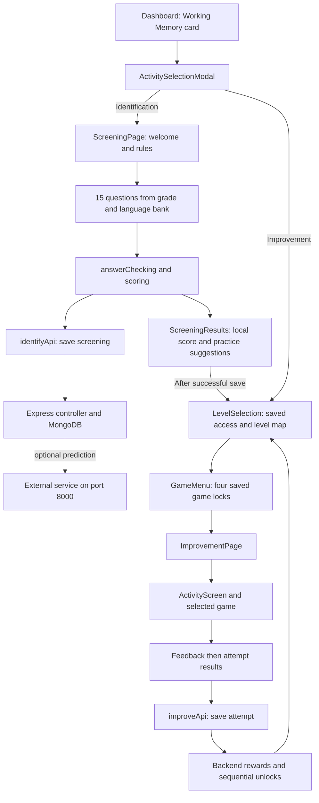

# Working Memory: beginner guide and documentation report

Documentation date: 19 October 2026. This describes the implementation found in this working copy.

The source edits for this task add explanatory comments. Existing source edits were preserved. No dependency was installed, and no question, answer, route, schema, CSS declaration, reward or unlock rule was changed.

## How to read the comments

Start with **FILE PURPOSE**, **HOW IT CONNECTS** and **THINGS TO REMEMBER** at the beginning of a file. Then search for:

- **REMEMBER**: what a state variable or ref holds and which interaction changes it.
- **FUNCTION**: what a function does, when it runs and what follows it.
- **EFFECT**: external work synchronized with rendering, dependencies and cleanup.
- **RETURN / UI SECTION**: where a visible part of the screen is created.
- **SECTION / SELECTOR** in CSS: which visual area a rule controls and how to adjust it.
- **QUESTION** in screening data: the question category and its presentation/checking path.

A React component is a function that describes part of the screen. JSX is its HTML-like markup. Props are inputs supplied by a parent. State remembers changing values and schedules another render when its setter runs. A ref remembers a DOM element or mutable value without causing a render. An effect synchronizes browser/API/timer work and can return cleanup.

## The application connections

`frontend/src/App.jsx` registers these existing routes:

| URL | Component | Meaning |
| --- | --- | --- |
| `/dashboard` | `pages/common/Dashboard.jsx` | Home and module choices |
| `/working-memory/:grade` | `identification/ScreeningPage.jsx` | Screening/demo for the selected grade |
| `/improvement-wm/:grade` | `improvement/LevelSelection.jsx` | Four-level map |
| `/improvement-wm/:grade?level=N` | Same map, plus `GameMenu.jsx` | Reopen the selected level menu |
| `/improvement-activity-wm/:grade/:levelNumber/:subCategoryKey` | `improvement/ImprovementPage.jsx` | Shared controller for one game attempt |

The parameters are strings read through `useParams`. The stable game keys are `pattern`, `words`, `instructions`, `numbers`. **`words` means Picture Memory** and is already part of URLs, API payloads and database records.

## Screening: all 15 questions

The entry point is `identification/ScreeningPage.jsx`. It separates `entryPhase` (`welcome`, `briefing`, `quiz`) from question `phase` (`memorize`, `audio`, `answer`). A real test uses the full bank. A normal demo picks two existing questions; explicit demo IDs can select a subset. Demo mode does not save results.

`identification/data/index.js` combines `grade2.js`, `grade3.js`, `grade4.js`. Each grade contains `en` and `si` arrays with **15 questions per language**. UI dictionaries in `src/locales/en/wm.json` and `src/locales/si/wm.json` are separate from those question arrays. JSON dictionaries were reviewed and left unchanged because JSON does not allow comments.

| Question positions | Category | Source fields | Screen behaviour |
| --- | --- | --- | --- |
| 1-4 | Pattern | `text`, `options`, `correct` | Pattern remains visible; tap one answer |
| 5-7 | Picture Memory | `words`, `options`, `correct` | Study pictures; choose the correct pictured order |
| 8-11 | Instruction | `text`, `options`, `correct` | Listen/read the steps; choose the requested action/order |
| 12-15 | Number Memory | `sequence`, `options`, `correct` | Study the numbers; choose the remembered order |

The IDs use `wm-g2-1` or `wm-g2-si-1`, with the corresponding grade/position for other records. Every active question record now has a comment. The real test retains authored order; improvement attempts use a separate selection helper.

| Grade | Picture sequence lengths in questions 5-7 | Number sequence lengths in questions 12-15 | Study window for Pictures/Numbers |
| --- | --- | --- | --- |
| 2 | 2, 2, 2 | 2, 3, 3, 4 | 8 seconds |
| 3 | 3, 3, 3 | 3, 3, 4, 4 | 7 seconds |
| 4 | 3, 4, 4 | 3, 4, 4, 4 | 6 seconds |

Patterns, instructions, choices and Sinhala wording are also authored in the individual grade banks; do not assume that changing grade only changes a timer.

`ScreeningQuestions.jsx` displays the supplied category/phase. Picture names resolve through `wordToImageMap`; pattern tokens use `PatternArtwork`; number sequences use `NumberSequence`. The tracker reads `current` and already recorded `responses`. `current` starts at zero, while its visible label adds one.

Tapping an answer calls the view's `answer`, then the controller's `handleSubmit`. Both use refs to prevent repeated taps. `evaluateIdentifyAnswer` checks the authored answer and returns correctness/error type. The controller appends a response and **advances automatically**. There is no separate screening Next button. After question 15, it selects the results view and saves the real attempt.

Each response records question ID, category, answer, expected answer, correctness, error type, answer time and allocated memorization time. Screening answer time is measured in milliseconds **after** study/listening finishes. There is no per-question retry count in this screening flow. If instruction speech is unavailable, the view provides a manual Continue action to reach recall.

## Screening scoring, ML and placement

`logic/scoring.js` calculates these values from the recorded responses:

| Value | Calculation |
| --- | --- |
| Recall accuracy | Correct answers / response count × 100 |
| Average response time | Sum of recorded answer milliseconds / response count |
| Digit span | Longest correctly answered Number Memory sequence |
| Normalized digit span | Achieved span / largest available number span × 100 |
| Sequence score | Average Number Memory error weight × 100 |
| Instruction score | Correct instruction responses / instruction responses × 100 |
| Pattern score | Correct pattern responses / pattern responses × 100 |
| Time score | 100 through 15 seconds; five points lost per started extra second, minimum five |

Sequence weights are `correct:1`, `partial_recall:0.5`, `wrong_order:0.4`, `skipped:0.2`, `incorrect:0`. The current multiple-choice number records generally produce correct/incorrect rather than exercising every free-recall classification branch. `analyzeSequenceError` checks partial positional matches before the reordered-digit branch.

The weighted final score is **25% accuracy + 25% normalized span + 15% sequence + 15% instruction + 10% pattern + 10% time**. Scores of at least 75 produce Low risk; at least 45 produce Moderate; lower produces High. Component scores below 50 create weak-area labels. Normal page callers provide nonempty completed arrays; the helper does not independently guard the accuracy/time divisions against empty input.

`services/identifyApi.js` sends responses and metrics to the identification router. The backend derives totals from submitted response flags and attempts `POST http://127.0.0.1:8000/predict` with seven features: recallAccuracy, digitSpan, sequenceScore, instructionScore, patternScore, avgResponseTime, timeScore. A successful response attaches `mlPrediction` and `mlConfidence`; a failed prediction does not stop the database save. The predictor implementation, training code and Working Memory model artifacts were not found in this repository, so their algorithm or training performance cannot be established from this code.

The immediate results screen displays the **locally calculated** score/risk. It does not replace that display with the backend ML response. Mistake-based practice recommendations are another calculation in `logic/progression.js`: rank categories by mistake count, then error rate, then stable category order. The illustrated results view shows at most two suggested categories.

Initial improvement placement is chosen by `determineLevelFromIdentification` in the backend improvement controller, using the **oldest** screening when progress is first created:

| Recognized risk label | Initial maximum unlocked level |
| --- | --- |
| High / Severe | 1 |
| Moderate / Medium | 2 |
| Low / Mild | 3 |
| No Risk / Minimal / Low Risk | 4 |

ML prediction takes precedence over submitted rule-based risk. An unrecognized/missing risk label falls back to raw correct percentage: below 40 → Level 1; below 65 → Level 2; below 85 → Level 3; otherwise Level 4. These are the implemented mappings; they do not establish the external model's actual output labels. Existing progress is not recalculated simply because a later screening is saved.

## Improvement: four games and four levels

`ImprovementPage.jsx` owns access, questions, timers, arrangements, response records, rewards and saving. `ActivityScreen.jsx` decides what to display. Each game receives props and calls controller callbacks, keeping scoring/persistence consistent rather than copying those rules four times.

`improvement/data/index.js` selects `grade → language → level → game`. It preserves bank metadata but overrides Pattern questions with `pattern/questions.js` and Picture questions with `pictures/questions.js`. Instructions and Numbers use their banks directly. `selectAttemptQuestions` chooses up to five questions and prefers IDs absent from the previous attempt. Pools containing five cannot supply five completely new questions on replay. Level 4 Pattern pools contain a sixth grid question; an attempt still chooses at most five.

| Game | Existing sequence of screens/actions | Answer check |
| --- | --- | --- |
| Pattern | How to Play → visible pattern → select option → Check → feedback → Next | Selected token equals `missingAnswer` |
| Picture Memory | How to Play → Ready → ten-second study → recall slots/pool → Submit → feedback → Next | Stable picture IDs match expected order, with no duplicates |
| Instruction Following | How to Play → Listen → playback complete → Show question → tap a recall answer → feedback → Next | Selected choice equals `correct` |
| Number Memory | How to Play → Ready → timed study → keypad recall → Submit → feedback → Next | String-normalized digit array equals authored `correct` |

All patterns, picture rows and number sequences are authored data. Randomness selects/shuffles existing questions or choices; it does not create new numeric sequences or infer new correct answers.

Picture recall supports tapping pool items, dragging into slots, swapping/clearing slots and Undo snapshots. Current setup uses only the remembered pictures in its playable pool even when data declares additional distractors. Retained deck/Start over branches exist, but the current supported-level view uses the visible pool and does not display that extra Start over button.

Numbers uses a reusable 0-9 keypad, so repeated digits can be entered. Undo removes the last filled slot. Backward questions already store the reversed expected sequence in their bank. Reveal windows are Level 1: 12 seconds, Level 2: 10, Level 3: 8, Level 4: 6; these come from `config/gameConfig.js`. Picture study is ten seconds across current levels. Instruction progression waits for listening/Show question rather than a shared reveal countdown.

`startQuiz` resets the attempt. `setupQuestion` resets a question's guards, timing, feedback and arrangement. `evaluateAnswer` accepts an answer once and records its elapsed milliseconds. `handleNextQuestion` advances after feedback, or opens results and calls `handleCompleteQuiz` after the last answer. Improvement per-question timing includes Ready/study/listening/recall; whole-attempt `totalTimeTaken` is converted to seconds.

## Scores, stars, saving and unlocks

| System | Meaning |
| --- | --- |
| Screening finalScore | Weighted assessment out of 100; not improvement stars |
| Improvement score | Count of correct questions in the current attempt |
| Improvement stars | Five for every correct answer; normally up to 25 per five-question attempt |
| Passing | At least three correct in an attempt |
| Level-card completion | Number of saved completed games out of four |
| Recorded game/level stars | Sum of saved attempt rewards, including replays |
| Home-page stars | Combined module total from the student profile endpoint |

The backend improvement controller validates grade/level/game, result count, same-grade screening existence and saved game access. It accepts submitted scores rather than independently checking a server-side question bank. A successful attempt save creates history, updates best score/attempt count, awards stars and updates progress. Rewards also apply to correct answers in failed attempts and replays.

Game order is Pattern → Pictures (`words`) → Instructions → Numbers. A pass permanently completes a game and unlocks the next game. A later failed replay does not remove its earlier completion. Four saved game completions finish a level; finishing the highest unlocked level opens the next level's Pattern game. Initial placement opens levels up to its maximum, but only Pattern starts open inside each of those levels.

The current attempt POST and subsequent progress/history refreshes have separate states. Once the POST succeeds, refresh failure retries a **read**, not the already-saved reward POST. Refs prevent local repeated submissions and stale responses after replay. The backend's attempt, student and progress updates are separate writes, without a transaction or request idempotency key; local guards do not establish server-wide idempotency.

MongoDB records are defined in the two model files. Screening stores one document per test. Improvement stores one progress document per student plus a separate attempt log; grade/language belong to attempts, not the unique progress key. `totalCarrots`/`carrotsEarned` are compatibility fields for the same reward, not an additional currency.

## Images, CSS, fonts and audio: where to look

The illustrated design is layered: background artwork, frame/card artwork, then live JSX text and controls. A browser URL such as `/images/workingMemory/...` resolves to `frontend/public/images/workingMemory/...`. Most rabbits, leaves, vine borders and coloured card bars are already in image files; CSS places/sizes them.

| Visual area | JSX or configuration | CSS |
| --- | --- | --- |
| Home and WM module entry | `pages/common/Dashboard.jsx` | `pages/common/dashboard.css` |
| Home activity popup | `components/common/ActivitySelectionModal.jsx` | `components/common/activitySelectionModal.css` |
| Screening welcome/rules | `identification/ScreeningIntro.jsx` | `styles/identificationScreens.css` |
| Screening question/score/tracker | `ScreeningQuestions.jsx`, `shared/ScreeningResults.jsx` | `identification.css`, `identificationScreens.css`, `contentRefinement.css` |
| Level-map forest/title/menu | `LevelSelection.jsx`, `GameMenu.jsx` | `memoryUI.css`, `popupMap.css` |
| Four rabbit cards/live labels | `LevelMapCard.jsx`, `config/levelMapCards.js` | `levelMapCards.css` |
| Shared stage/nav/board/bunny | `shared/GameLayout.jsx`, `config/levelThemes.js` | `memoryUI.css` plus screen overrides |
| Tutorial | `shared/HowToPlay.jsx`, `config/gameConfig.js` | `howToPlay.css` |
| Four game layouts | `improvement/games/*.jsx` | `memoryUI.css`, `contentRefinement.css`, `gameLevels.css`, `improvementLayout.css` |
| Pattern-specific question | `PatternGame.jsx` | `patternReference.css` plus shared layout overrides |
| Pattern illustration fitting | `shared/artwork/PatternArtwork.jsx` | `patternArtwork.css` |
| Feedback | `shared/Feedback.jsx` | `memoryUI.css`, `patternReference.css`, `improvementLayout.css` |
| Per-game and level result boards | `ActivityResults.jsx`, `LevelCompletion.jsx` | `patternReference.css`, `levelOneDashboard.css`, `improvementLayout.css` |
| Wooden star/music/language controls | Shared common controls and `MemoryNav` | `components/common/woodenNavControls.css` plus caller overrides |

`MemoryStage` uses a fixed 1600×900 design stage fitted with the smaller browser-width/height scale. `position:relative` establishes an anchor; `position:absolute` places overlays within that anchor. `z-index` controls overlapping layers. Flex arranges items along a row/column; grid defines rows/columns. Padding is inside space, margin outside space, gap between items. A matching later/more-specific CSS rule can override an earlier rule. `:lang(si)` adjusts Sinhala presentation; reduced-motion media queries reduce animation.

The actual shared component names are `MemoryNav` (header), `MemoryTracker` (question tracker), `MemoryBoard` (vine board), `MemoryBunny` (mascot and optional thought bubble), `HowToPlay`, `ActivityResults` and `LevelCompletion`. There are no separate active `GameHeader`, `VineBoard`, `ThoughtBubble` or `ResultDashboard` files to edit in this feature.

`config/levelThemes.js` selects orange/green/pink/purple accents and level scenery; `config/levelMapCards.js` selects the complete rabbit card PNGs. `patternSymbols.js` maps stable tokens to grade/level image paths. `pictures/questions.js` builds stable picture id/image/translated-alt objects. `GameLayout`/`DashboardBunny` select game/result bunny poses; gameConfig selects the guidance text. Map popup close artwork is shared with the dashboard.

`frontend/public/fonts/workingMemory/fonts.css` declares local Fredoka, Lexend and Noto Sans Sinhala faces. The screen selectors decide actual font size/line height. Font binaries and other assets were not edited.

`logic/audio.js` owns looping `/audio/workingMemory/bgmusic.mp3`, a persistent background-mute preference, synthesized answer sounds and number-keypad tones. The route listener is mounted once in App. Mute affects background music; explicit instruction/answer/keypad playback is separate.

Screening uses browser speech with language-specific voice selection and a manual fallback if unavailable. Instruction improvement first looks for `/audio/workingMemory/instructions/grade3/{en|si}/{questionId}.mp4`; failed/absent recordings fall back to browser speech. The asset inventory contains 20 Sinhala MP4 recordings and an English folder with a README only. The current Sinhala instruction banks for Grades 2 and 4 intentionally reuse Grade 3 Sinhala question data/IDs. Tutorial URL selection lives in gameConfig and the game metadata; `HowToPlay` supports YouTube embeds or direct video URLs. No external video/model availability was tested by this documentation task.

## Existing gaps and distinctions to explain honestly

- Screening recommendations append `?recommended=gameKey`, but LevelSelection currently reads only `?level=`. Suggestions do not directly open that game or bypass locks.
- The admin `WMImproveResults.jsx` screen is a placeholder without history/API loading.
- The student improvement history table retains a `score >= 2` badge condition; actual current passing/unlocking requires at least three correct.
- `videoWatched` exists in saved progress, but this current tutorial flow does not update it. Watching the tutorial is not an implemented completion prerequisite.
- Initial placement uses the oldest screening, while home weak-area reporting uses the latest. Progress is per student across grades/languages, although attempt submission checks screening for the submitted grade.
- The external Working Memory ML predictor is called but its implementation/artifacts are absent from this repository. A successful frontend build cannot validate that service.
- Both WM route files currently omit their own token/role middleware. Frontend protected routes and Axios token headers are distinct from server-side authorization.
- Old Pattern result, inline feedback, emoji picture-bank and deck-interaction branches are retained. The current supported-level views use the newer shared results, normal feedback, image-object questions and visible picture pool.
- Existing audio-folder README instructions still say Sinhala Grades 2/4 do not share the recordings; the active bank assignment now does share Grade 3 Sinhala records. The guide and source comments follow the active code, while those older README files remain untouched.

## Verification

- Frontend production build passed before documentation, after the first comment pass, and after all 85 files were documented. Existing browser-data/chunk-size warnings appeared before and after the edits.
- `node --check` passed for all 11 documented backend JavaScript files, without starting a server or connecting to a database.
- All **9 existing frontend unit-test files passed: 2,338 tests**, covering screening answers, improvement answers, recommendations, artwork/assets, recording/Sinhala behaviour, feedback and results rendering.
- The first sandboxed unit-test launch failed before tests could start because the runner could not read its configuration/ancestor directory. The approved run outside that restriction passed. This was an environment startup failure, not an assertion failure.
- A snapshot captured the working source before editing. Every documented JS/JSX file was parsed and its executable syntax tree compared with the snapshot, excluding comments/source locations and empty JSX comment containers. JSX text, imports, routes, strings, props, functions and data remain the same.
- Every documented CSS file was parsed and compared by ordered rules, selectors, at-rule conditions, declaration values and important flags after excluding comments. All match the snapshot. Original byte-order marks were preserved.
- Existing useful comments were retained. Asset binaries and JSON data were not modified. No application/API/browser end-to-end session or live database/model call was run; the checks above establish source preservation and local validation, not external service availability.

## Reviewed file inventory

Every source/style file listed below received comments. Paths are relative to the repository root; links open the existing file. Supporting reviewed files and the final validation record follow the inventory.

85 source/style files received comments.

| Reviewed and commented file | Purpose |
| --- | --- |
| [backend/src/app.js](../../backend/src/app.js) | Express application wiring, including the two Working Memory API route prefixes. |
| [backend/src/modules/admin/controllers/admin.controller.js](../../backend/src/modules/admin/controllers/admin.controller.js) | Shared administrator request handlers, including retrieval of Working Memory screening reports. |
| [backend/src/modules/admin/routes/admin.routes.js](../../backend/src/modules/admin/routes/admin.routes.js) | Shared admin API router, including Working Memory screening-report access. |
| [backend/src/modules/common/controllers/student.controller.js](../../backend/src/modules/common/controllers/student.controller.js) | Shared student API handlers that supply the dashboard and Working Memory access identity. |
| [backend/src/modules/common/routes/student.routes.js](../../backend/src/modules/common/routes/student.routes.js) | Shared student profile and learning-summary endpoints used by Working Memory entry/access. |
| [backend/src/modules/workingMemory/controllers/workingMemoryIdentify.controller.js](../../backend/src/modules/workingMemory/controllers/workingMemoryIdentify.controller.js) | Screening save/history request handlers and optional external ML prediction integration. |
| [backend/src/modules/workingMemory/controllers/workingMemoryImprove.controller.js](../../backend/src/modules/workingMemory/controllers/workingMemoryImprove.controller.js) | Improvement progress initialization, saved attempts, star rewards and authoritative unlock updates. |
| [backend/src/modules/workingMemory/models/workingMemoryIdentify.model.js](../../backend/src/modules/workingMemory/models/workingMemoryIdentify.model.js) | Mongoose schema for one completed screening attempt and its assessment features. |
| [backend/src/modules/workingMemory/models/workingMemoryImprove.model.js](../../backend/src/modules/workingMemory/models/workingMemoryImprove.model.js) | Mongoose schemas for current student progress and the separate detailed attempt log. |
| [backend/src/modules/workingMemory/routes/workingMemoryIdentify.routes.js](../../backend/src/modules/workingMemory/routes/workingMemoryIdentify.routes.js) | Screening save/history Express endpoint definitions. |
| [backend/src/modules/workingMemory/routes/workingMemoryImprove.routes.js](../../backend/src/modules/workingMemory/routes/workingMemoryImprove.routes.js) | Improvement progress/attempt/history Express endpoint definitions. |
| [frontend/public/fonts/workingMemory/fonts.css](../../frontend/public/fonts/workingMemory/fonts.css) | Local font declarations for Working Memory and shared illustrated controls. |
| [frontend/src/App.jsx](../../frontend/src/App.jsx) | Application route map; Working Memory uses screening, improvement map and activity routes. |
| [frontend/src/components/common/ActivitySelectionModal.jsx](../../frontend/src/components/common/ActivitySelectionModal.jsx) | Shared dashboard popup offering identification or improvement for the selected learning module. |
| [frontend/src/components/common/LanguageSwitcher.jsx](../../frontend/src/components/common/LanguageSwitcher.jsx) | Shared language control used by the dashboard and Working Memory navigation. |
| [frontend/src/components/common/WoodenNavControls.jsx](../../frontend/src/components/common/WoodenNavControls.jsx) | Shared illustrated star counter and background-music toggle used in Working Memory headers. |
| [frontend/src/components/common/activitySelectionModal.css](../../frontend/src/components/common/activitySelectionModal.css) | Style file for the shared dashboard activity-choice dialog. |
| [frontend/src/components/common/woodenNavControls.css](../../frontend/src/components/common/woodenNavControls.css) | Style file for illustrated stars, music and language controls reused in WM navigation. |
| [frontend/src/features/workingMemory/config/gameConfig.js](../../frontend/src/features/workingMemory/config/gameConfig.js) | Shared game settings, bilingual guidance, tutorial choices and result messages. |
| [frontend/src/features/workingMemory/config/instructionAudio.js](../../frontend/src/features/workingMemory/config/instructionAudio.js) | Question-ID-to-recording-path lookup for the listening improvement game. |
| [frontend/src/features/workingMemory/config/levelMapCards.js](../../frontend/src/features/workingMemory/config/levelMapCards.js) | Small immutable list of the four complete level-card artwork paths. |
| [frontend/src/features/workingMemory/config/levelThemes.js](../../frontend/src/features/workingMemory/config/levelThemes.js) | Configuration of level colours, shared image roots and screening artwork. |
| [frontend/src/features/workingMemory/identification/ScreeningIntro.jsx](../../frontend/src/features/workingMemory/identification/ScreeningIntro.jsx) | Reusable welcome dialog and instructions dialog shown before screening. |
| [frontend/src/features/workingMemory/identification/ScreeningPage.jsx](../../frontend/src/features/workingMemory/identification/ScreeningPage.jsx) | Page controller for the Working Memory screening, including its demo and real test. |
| [frontend/src/features/workingMemory/identification/ScreeningQuestions.jsx](../../frontend/src/features/workingMemory/identification/ScreeningQuestions.jsx) | Screening presentation components: shared forest/board shell, tracker, study material and answer choices. |
| [frontend/src/features/workingMemory/identification/data/grade2.js](../../frontend/src/features/workingMemory/identification/data/grade2.js) | Authored English and Sinhala screening questions for Grade 2; this is question data, not a React screen. |
| [frontend/src/features/workingMemory/identification/data/grade3.js](../../frontend/src/features/workingMemory/identification/data/grade3.js) | Authored English and Sinhala screening questions for Grade 3; this is question data, not a React screen. |
| [frontend/src/features/workingMemory/identification/data/grade4.js](../../frontend/src/features/workingMemory/identification/data/grade4.js) | Authored English and Sinhala screening questions for Grade 4; this is question data, not a React screen. |
| [frontend/src/features/workingMemory/identification/data/index.js](../../frontend/src/features/workingMemory/identification/data/index.js) | Data entry point that groups the three grade-specific screening banks. |
| [frontend/src/features/workingMemory/improvement/ActivityScreen.jsx](../../frontend/src/features/workingMemory/improvement/ActivityScreen.jsx) | Presentation switch that chooses which improvement screen or game is visible. |
| [frontend/src/features/workingMemory/improvement/GameMenu.jsx](../../frontend/src/features/workingMemory/improvement/GameMenu.jsx) | Selected-level popup showing the four improvement games. |
| [frontend/src/features/workingMemory/improvement/ImprovementPage.jsx](../../frontend/src/features/workingMemory/improvement/ImprovementPage.jsx) | Main controller shared by all four improvement games and Levels 1-4. |
| [frontend/src/features/workingMemory/improvement/LevelMapCard.jsx](../../frontend/src/features/workingMemory/improvement/LevelMapCard.jsx) | One reusable illustrated level button; the map creates four instances. |
| [frontend/src/features/workingMemory/improvement/LevelSelection.jsx](../../frontend/src/features/workingMemory/improvement/LevelSelection.jsx) | Improvement level map page with four illustrated cards and a selected-level game menu. |
| [frontend/src/features/workingMemory/improvement/data/index.js](../../frontend/src/features/workingMemory/improvement/data/index.js) | Question-bank assembler and lookup helper for grade, language, level and game. |
| [frontend/src/features/workingMemory/improvement/data/instructions/bank.js](../../frontend/src/features/workingMemory/improvement/data/instructions/bank.js) | Authored listening prompts, recall questions, choices and correct answers for the instruction game. |
| [frontend/src/features/workingMemory/improvement/data/numbers/bank.js](../../frontend/src/features/workingMemory/improvement/data/numbers/bank.js) | Authored Number Memory sequences and tutorial metadata across grades, languages and four levels. |
| [frontend/src/features/workingMemory/improvement/data/pattern/bank.js](../../frontend/src/features/workingMemory/improvement/data/pattern/bank.js) | Pattern game metadata for each grade, language and level. |
| [frontend/src/features/workingMemory/improvement/data/pattern/questions.js](../../frontend/src/features/workingMemory/improvement/data/pattern/questions.js) | Current authored visual Pattern Recognition question pools for each grade and level. |
| [frontend/src/features/workingMemory/improvement/data/pictures/bank.js](../../frontend/src/features/workingMemory/improvement/data/pictures/bank.js) | Older Picture Memory bank and per-grade/language tutorial metadata. |
| [frontend/src/features/workingMemory/improvement/data/pictures/questions.js](../../frontend/src/features/workingMemory/improvement/data/pictures/questions.js) | Current bilingual Picture Memory image-object questions built from authored rows. |
| [frontend/src/features/workingMemory/improvement/games/InstructionsGame.jsx](../../frontend/src/features/workingMemory/improvement/games/InstructionsGame.jsx) | Listening activity view that changes to a multiple-choice recall question. |
| [frontend/src/features/workingMemory/improvement/games/NumberMemoryGame.jsx](../../frontend/src/features/workingMemory/improvement/games/NumberMemoryGame.jsx) | Number Memory Ready, timed reveal and recall view with a digit keypad. |
| [frontend/src/features/workingMemory/improvement/games/PatternGame.jsx](../../frontend/src/features/workingMemory/improvement/games/PatternGame.jsx) | Pattern question view with local selection, a Check button and feedback; also retains a legacy result view. |
| [frontend/src/features/workingMemory/improvement/games/PictureMemoryGame.jsx](../../frontend/src/features/workingMemory/improvement/games/PictureMemoryGame.jsx) | Picture Memory study and recall view; stored under the historic game key words. |
| [frontend/src/features/workingMemory/logic/answerChecking.js](../../frontend/src/features/workingMemory/logic/answerChecking.js) | Pure answer checkers shared by screening and improvement controllers. |
| [frontend/src/features/workingMemory/logic/audio.js](../../frontend/src/features/workingMemory/logic/audio.js) | Shared background music store, route listener and synthesized game sounds. |
| [frontend/src/features/workingMemory/logic/instructionRecording.js](../../frontend/src/features/workingMemory/logic/instructionRecording.js) | Small recorded-audio player with a cleanup function and completion/error callbacks. |
| [frontend/src/features/workingMemory/logic/presentation.js](../../frontend/src/features/workingMemory/logic/presentation.js) | Small display helpers for tutorial URLs, spoken instruction steps and shuffled copies. |
| [frontend/src/features/workingMemory/logic/progression.js](../../frontend/src/features/workingMemory/logic/progression.js) | Read-only saved-progress helpers, attempt question selection and screening practice recommendations. |
| [frontend/src/features/workingMemory/logic/scoring.js](../../frontend/src/features/workingMemory/logic/scoring.js) | Pure calculation of screening assessment metrics, final score, risk and weak areas. |
| [frontend/src/features/workingMemory/services/identifyApi.js](../../frontend/src/features/workingMemory/services/identifyApi.js) | Frontend HTTP wrappers for saving and reading screening attempts. |
| [frontend/src/features/workingMemory/services/improveApi.js](../../frontend/src/features/workingMemory/services/improveApi.js) | Frontend HTTP wrappers and a short-lived cache for improvement access/progress. |
| [frontend/src/features/workingMemory/shared/ActivityResults.jsx](../../frontend/src/features/workingMemory/shared/ActivityResults.jsx) | Shared per-game result dashboard for all supported improvement levels, plus a retained legacy view. |
| [frontend/src/features/workingMemory/shared/Feedback.jsx](../../frontend/src/features/workingMemory/shared/Feedback.jsx) | Reusable correct/incorrect messages shown after an improvement answer. |
| [frontend/src/features/workingMemory/shared/GameLayout.jsx](../../frontend/src/features/workingMemory/shared/GameLayout.jsx) | Reusable visual building blocks for screening, level map and all improvement games. |
| [frontend/src/features/workingMemory/shared/HowToPlay.jsx](../../frontend/src/features/workingMemory/shared/HowToPlay.jsx) | Reusable tutorial video board shown before each improvement attempt. |
| [frontend/src/features/workingMemory/shared/LevelCompletion.jsx](../../frontend/src/features/workingMemory/shared/LevelCompletion.jsx) | Four-game overview displayed after the final game when saved progress marks the level complete. |
| [frontend/src/features/workingMemory/shared/ScreeningResults.jsx](../../frontend/src/features/workingMemory/shared/ScreeningResults.jsx) | Screening score/risk display, practice suggestions and demo completion view. |
| [frontend/src/features/workingMemory/shared/artwork/PatternArtwork.jsx](../../frontend/src/features/workingMemory/shared/artwork/PatternArtwork.jsx) | Reusable image renderer for authored pattern tokens, with a text/children fallback. |
| [frontend/src/features/workingMemory/shared/artwork/PictureArtwork.jsx](../../frontend/src/features/workingMemory/shared/artwork/PictureArtwork.jsx) | Reusable picture renderer that fits the visible part of transparent PNGs into a frame. |
| [frontend/src/features/workingMemory/shared/artwork/patternSymbols.js](../../frontend/src/features/workingMemory/shared/artwork/patternSymbols.js) | Map of stable pattern tokens to labels, image names and original dimensions. |
| [frontend/src/features/workingMemory/styles/contentRefinement.css](../../frontend/src/features/workingMemory/styles/contentRefinement.css) | Style file: Additional readable question/answer and artwork sizing rules for screening and improvement. |
| [frontend/src/features/workingMemory/styles/gameLevels.css](../../frontend/src/features/workingMemory/styles/gameLevels.css) | Style file: Level-specific improvement layout, sequence/card sizes, number keypad and feedback adjustments. |
| [frontend/src/features/workingMemory/styles/howToPlay.css](../../frontend/src/features/workingMemory/styles/howToPlay.css) | Style file: Tutorial board, bunny, video frame, poster and playback/start buttons. |
| [frontend/src/features/workingMemory/styles/identification.css](../../frontend/src/features/workingMemory/styles/identification.css) | Style file: Base screening question, answer, completion and recommendation appearance. |
| [frontend/src/features/workingMemory/styles/identificationScreens.css](../../frontend/src/features/workingMemory/styles/identificationScreens.css) | Style file: Current screening welcome/rules dialogs, question layout, standing bunny and result arrangement. |
| [frontend/src/features/workingMemory/styles/improvementLayout.css](../../frontend/src/features/workingMemory/styles/improvementLayout.css) | Style file: Final shared content spacing for all four improvement games and result boards. |
| [frontend/src/features/workingMemory/styles/levelMapCards.css](../../frontend/src/features/workingMemory/styles/levelMapCards.css) | Style file: Illustrated level-card sizing and the text laid over each PNG. |
| [frontend/src/features/workingMemory/styles/levelOneDashboard.css](../../frontend/src/features/workingMemory/styles/levelOneDashboard.css) | Style file: Shared game-result and level-completion dashboard styles used across Levels 1-4. |
| [frontend/src/features/workingMemory/styles/memoryUI.css](../../frontend/src/features/workingMemory/styles/memoryUI.css) | Style file: Base forest stage, navigation, vine board, tracker, reusable controls and game layout. |
| [frontend/src/features/workingMemory/styles/patternArtwork.css](../../frontend/src/features/workingMemory/styles/patternArtwork.css) | Style file: Pattern image-cell fitting and compound-token layout. |
| [frontend/src/features/workingMemory/styles/patternReference.css](../../frontend/src/features/workingMemory/styles/patternReference.css) | Style file: Pattern question presentation and shared illustrated result-board appearance. |
| [frontend/src/features/workingMemory/styles/popupMap.css](../../frontend/src/features/workingMemory/styles/popupMap.css) | Style file: Level-map headings/navigation and the selected-level game popup. |
| [frontend/src/i18n.js](../../frontend/src/i18n.js) | Translation setup shared across the application, including Working Memory. |
| [frontend/src/pages/admin/components/WMIdentifyResults.jsx](../../frontend/src/pages/admin/components/WMIdentifyResults.jsx) | Administrator view of saved Working Memory screening attempts with filters, details and exports. |
| [frontend/src/pages/admin/components/WMImproveResults.jsx](../../frontend/src/pages/admin/components/WMImproveResults.jsx) | Administrator improvement-report placeholder screen. |
| [frontend/src/pages/common/Dashboard.jsx](../../frontend/src/pages/common/Dashboard.jsx) | Student home page and entry into Working Memory screening or improvement. |
| [frontend/src/pages/common/dashboard.css](../../frontend/src/pages/common/dashboard.css) | Style file for the student home page and its Working Memory module card. |
| [frontend/src/pages/common/reports/IdentifyWorkingMemoryReport.jsx](../../frontend/src/pages/common/reports/IdentifyWorkingMemoryReport.jsx) | Student screening history page showing saved assessment metrics and a score trend. |
| [frontend/src/pages/common/reports/ImproveWorkingMemoryReport.jsx](../../frontend/src/pages/common/reports/ImproveWorkingMemoryReport.jsx) | Student improvement report showing saved unlocks, attempts and performance history. |
| [frontend/src/services/api.js](../../frontend/src/services/api.js) | Shared Axios connection used by Working Memory and other feature services. |
| [frontend/src/services/student/api.js](../../frontend/src/services/student/api.js) | Shared student/profile service used to enter Working Memory with the current student and grade. |
| [frontend/src/utils/studentProfileCache.js](../../frontend/src/utils/studentProfileCache.js) | Shared session profile cache used by Dashboard and Working Memory navigation. |
| [frontend/src/utils/warmImages.js](../../frontend/src/utils/warmImages.js) | Shared image preloading helpers used by the home page before entering Working Memory. |

### Supporting files reviewed without edits

| File | Review purpose |
| --- | --- |
| [frontend/src/locales/en/wm.json](../../frontend/src/locales/en/wm.json) | English WM UI dictionary; kept valid JSON without comments. |
| [frontend/src/locales/si/wm.json](../../frontend/src/locales/si/wm.json) | Sinhala WM UI dictionary; kept valid JSON without comments. |
| [frontend/src/modules/workingMemory/sample.jsx](../../frontend/src/modules/workingMemory/sample.jsx) | Empty legacy placeholder; active code is in features/workingMemory. |
| [frontend/src/utils/phonologicalAwareness/audio.js](../../frontend/src/utils/phonologicalAwareness/audio.js) | Existing stopAllAudio helper imported by screening/App; shared cleanup reviewed without editing the PA-owned utility. |
| [backend/src/middleware/auth.middleware.js](../../backend/src/middleware/auth.middleware.js) | Student/admin middleware connection reviewed; distinguishes protected shared routes from WM routers. |
| [frontend/vitest.config.js](../../frontend/vitest.config.js) | Existing nine-file unit-test configuration; no config edits. |
| [frontend/package.json](../../frontend/package.json) | Available build/unit validation scripts; no dependency changes. |
| [backend/package.json](../../backend/package.json) | Backend runtime/scripts inspected; validation used node --check without loading database services. |
| [frontend/src/features/workingMemory/README.md](../../frontend/src/features/workingMemory/README.md) | Existing feature map, image layout and timing/reward overview. |
| [frontend/src/pages/common/README.md](../../frontend/src/pages/common/README.md) | Existing home integration/artwork map; active code is authoritative for current paths. |
| [frontend/public/images/workingMemory/level-map/cards/README.md](../../frontend/public/images/workingMemory/level-map/cards/README.md) | Card dimensions, blank controls, generation provenance and live labels. |
| [frontend/public/audio/workingMemory/instructions/grade3/en/README.md](../../frontend/public/audio/workingMemory/instructions/grade3/en/README.md) | Future English recording instructions; directory currently has no MP4 recordings. |
| [frontend/public/audio/workingMemory/instructions/grade3/si/README.md](../../frontend/public/audio/workingMemory/instructions/grade3/si/README.md) | Recording convention; older Grade 2/4 wording differs from current shared Sinhala bank. |
| [tests/working-memory/unit/wm-logic.spec.ts](../../tests/working-memory/unit/wm-logic.spec.ts) | Additional Playwright-run logic suite inspected; not run in this documentation task. |
| [tests/working-memory/api/wm-api.spec.ts](../../tests/working-memory/api/wm-api.spec.ts) | Additional live-backend API scenarios inspected; not executed. |
| [tests/working-memory/e2e/wm-session.spec.ts](../../tests/working-memory/e2e/wm-session.spec.ts) | Additional browser-session scenarios inspected; not executed. |
| [frontend/tests/unit/identifyAnswers.test.js](../../frontend/tests/unit/identifyAnswers.test.js) | Existing test file reviewed through its source/imports and executed successfully; not edited. |
| [frontend/tests/unit/improvementAnswers.test.js](../../frontend/tests/unit/improvementAnswers.test.js) | Existing test file reviewed through its source/imports and executed successfully; not edited. |
| [frontend/tests/unit/improvementFeedback.test.jsx](../../frontend/tests/unit/improvementFeedback.test.jsx) | Existing test file reviewed through its source/imports and executed successfully; not edited. |
| [frontend/tests/unit/instructionRecording.test.js](../../frontend/tests/unit/instructionRecording.test.js) | Existing test file reviewed through its source/imports and executed successfully; not edited. |
| [frontend/tests/unit/instructionSinhala.test.js](../../frontend/tests/unit/instructionSinhala.test.js) | Existing test file reviewed through its source/imports and executed successfully; not edited. |
| [frontend/tests/unit/patternArtwork.test.js](../../frontend/tests/unit/patternArtwork.test.js) | Existing test file reviewed through its source/imports and executed successfully; not edited. |
| [frontend/tests/unit/practiceRecommendations.test.js](../../frontend/tests/unit/practiceRecommendations.test.js) | Existing test file reviewed through its source/imports and executed successfully; not edited. |
| [frontend/tests/unit/resultsRendering.test.jsx](../../frontend/tests/unit/resultsRendering.test.jsx) | Existing test file reviewed through its source/imports and executed successfully; not edited. |
| [frontend/tests/unit/workingMemoryAssets.test.js](../../frontend/tests/unit/workingMemoryAssets.test.js) | Existing test file reviewed through its source/imports and executed successfully; not edited. |

### Asset inventory reviewed

Artwork selection was traced through source paths and the existing asset inventory. This is a path/usage review, not a claim of visually inspecting every binary image. No asset was generated or edited.

| Folder | Files inventoried | Purpose |
| --- | ---: | --- |
| [frontend/public/images/workingMemory](../../frontend/public/images/workingMemory) | 540 | Dedicated screening, level-map, game and shared artwork. |
| [frontend/public/audio/workingMemory](../../frontend/public/audio/workingMemory) | 23 | Background music, twenty Sinhala instruction recordings and folder READMEs. |
| [frontend/public/fonts/workingMemory](../../frontend/public/fonts/workingMemory) | 12 | Local font faces and styles. |

## Viva quick lookup

| Examiner question | Where to open and what to explain |
| --- | --- |
| Where did you build this screen? | App.jsx selects a routed controller; ScreeningPage/LevelSelection/ImprovementPage decide flow and their view components create the JSX. |
| Where is the bunny positioned? | MemoryBunny or DashboardBunny supplies the image; .lx-bunny/.lx-thought in memoryUI.css or the relevant result/screen override places it. Screening uses its standing-bunny classes. |
| How is the vine board created? | MemoryBoard returns a section/content container. memoryUI.css applies the vine background image. The question/buttons are live children over that image. |
| Where can I change a button colour? | Read LEVEL_THEMES for shared level colours and the matching button selector. Some illustrated colours are baked into PNGs, so changing CSS text colour alone cannot recolour that artwork. |
| How are all 15 screening questions loaded? | ScreeningPage buildQuizSet selects QUIZ_DATA[grade][language] from identification/data. The real session uses the full fifteen-record array. |
| How does Next work? | Screening advances directly in handleSubmit. Improvement handleNextQuestion runs after feedback and either calls setupQuestion or final save. |
| Why use React state? | Current question, selected option, phase and save status change over time. Their setters cause the dependent JSX to render again. Refs hold guards/timestamps without rendering. |
| What does this effect do? | Read the nearby EFFECT guide, dependency array and returned cleanup. Effects handle fetching, timing, media, keyboard listeners or artwork warming, depending on the file. |
| How do English and Sinhala work? | i18n.js registers wm dictionaries; useTranslation selects UI labels. Data lookup separately selects en/si question banks. Stable IDs keep correctness independent of translated labels. |
| How is screening scored? | logic/scoring.js computes weighted features/risk. It differs from improvement score count and five-star rewards. |
| How are the four games connected? | One ImprovementPage controller, ActivityScreen game switch and shared props/callbacks; backend progress unlocks pattern/words/instructions/numbers sequentially. |
| How do level backgrounds change? | MemoryStage chooses bg-levelN.webp and CSS variables from LEVEL_THEMES. The map supplies an explicit forest override. |
| How does the trained model connect? | Identification controller sends seven features to the external predict endpoint. Prediction is optional for saving; model code is not present here. Backend placement can read the returned label. |
| How is progress saved? | improveApi POSTs one attempt. Backend models store attempt history and update student progress/rewards. Successful response, not local score alone, confirms saving. |
